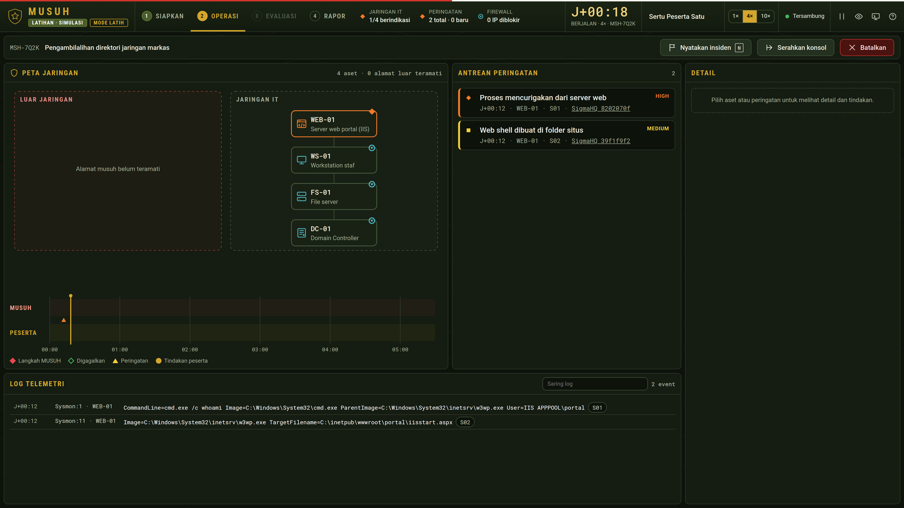

<h1 align="center">MUSUH · Mesin Uji Serangan dan Ketahanan</h1>

<p align="center">
  <b>Lawan tanding siber untuk satuan TNI AD. Satu laptop, tanpa internet.</b><br>
  MUSUH menyerang jaringan latihan di dalam laptop, berganti jalur bila satu jalan diblokir, menilai peserta GO/NO-GO, lalu menerbitkan Rapor Prestasi Siber yang bisa diperiksa ulang dengan memutar ulang latihannya.
</p>

<p align="center">
  <a href="https://github.com/daefery/musuh/releases/latest/download/musuh.exe"></a>
  <a href="https://github.com/daefery/musuh/releases/latest/download/musuh-linux"></a>
  <a href="docs/slides/MUSUH-slides.pdf"></a>
</p>

<p align="center">
  
  <a href="LICENSE"></a>
  
  
</p>



## Mencoba dalam 1 menit (Windows)
1. Unduh **[musuh.exe](https://github.com/daefery/musuh/releases/latest/download/musuh.exe)** (2 MB). Salinannya juga ada di folder [`dist/`](dist/) dan di halaman [Releases](https://github.com/daefery/musuh/releases).
2. Klik dua kali `musuh.exe`. Peramban terbuka ke `http://127.0.0.1:8090/`.
3. Bila Windows menampilkan **"Windows protected your PC"**: klik **More info**, lalu **Run anyway**. Peringatan ini muncul karena program belum ditandatangani sertifikat digital; program tidak memakai internet dan hanya membuka port lokal 127.0.0.1.
4. SIAPKAN: isi nama, pilih skenario, tekan **Mulai latihan**.

Linux: unduh **[musuh-linux](https://github.com/daefery/musuh/releases/latest/download/musuh-linux)**, jalankan `chmod +x musuh-linux && ./musuh-linux`.

Memeriksa rapor dari baris perintah: `musuh.exe verify rapor\NAMA-BERKAS.json` (keluar 0 = SAH, 1 = TIDAK SAH).

## Dokumentasi teknis
| Dokumen | Isi |
|---|---|
| [Arsitektur sistem](docs/ARCHITECTURE.md) | Mesin, server lokal, konsol, format rapor, pengujian (English) |
| Panduan instalasi | Bagian [Mencoba dalam 1 menit](#mencoba-dalam-1-menit-windows) dan [Membangun dari kode sumber](#membangun-dari-kode-sumber) di halaman ini |
| [Cara penggunaan](docs/RUNBOOK.md) | Panduan operasi untuk pelatih dan peserta, dari SIAPKAN sampai RAPOR |
| [Batasan](docs/LIMITS.md) | Yang tidak dilakukan MUSUH, dinyatakan terbuka |
| [Sumber](docs/SOURCES.md) | Asal setiap isi skenario, teknik dan aturan deteksi; atribusi pihak ketiga |
| [Slide presentasi](docs/slides/MUSUH-slides.pdf) | 10 slide: latar belakang, solusi, teknologi, potensi implementasi |

## Membangun dari kode sumber
Butuh Rust 1.80 atau lebih baru.
```
cargo build --release -p musuh                                              # Linux / macOS / Windows (native)
cargo zigbuild --release -p musuh --target x86_64-pc-windows-gnu            # silang ke Windows dari Linux
```

## Pengujian
```
cargo test -p musuh-engine                          # 13 uji perilaku + 1 uji kesetaraan dengan purwarupa
cd test && npm install && cd ..                     # sekali, untuk uji peramban (butuh Chrome terpasang)
node test/e2e.mjs 1440 900 target/release/musuh     # 74 pemeriksaan alur di peramban
node test/toolbar.mjs target/release/musuh          # bilah atas di 1093-1920 px, normal dan presentasi
node test/layout.mjs target/release/musuh           # pilih peringatan, tindakan, konfirmasi, batal di 8 ukuran layar
```

## Isi repositori
- `crates/engine`: mesin latihan murni (tanpa IO, tanpa jam): skenario, musuh deterministik, deteksi, nilai, rapor, verifikasi.
- `crates/app`: program `musuh`: server lokal 127.0.0.1, jam latihan, penyimpanan rapor, perintah `verify`.
- `web`: konsol (HTML, CSS, JavaScript) yang ditanam di dalam program.
- `test`: uji peramban. `docs`: dokumen dan slide. `dist`: `musuh.exe` siap pakai (sidik SHA-256 di `SHA256SUMS.txt`).

## Lisensi dan atribusi
Kode: MIT, lihat `LICENSE`. Bentuk simbol status mengikuti Astro UXDS (c) Rocket Communications, Inc. (`web/ASTRO-LICENSE.txt`); tidak ada dukungan dari pemerintah AS. Huruf Roboto, Roboto Condensed dan Roboto Mono: SIL Open Font License 1.1.
Skenario adalah latihan rekaan berbasis insiden publik; alamat IP luar memakai rentang dokumentasi RFC 5737. Tidak menyentuh sistem nyata.

Dibuat oleh Fery.
